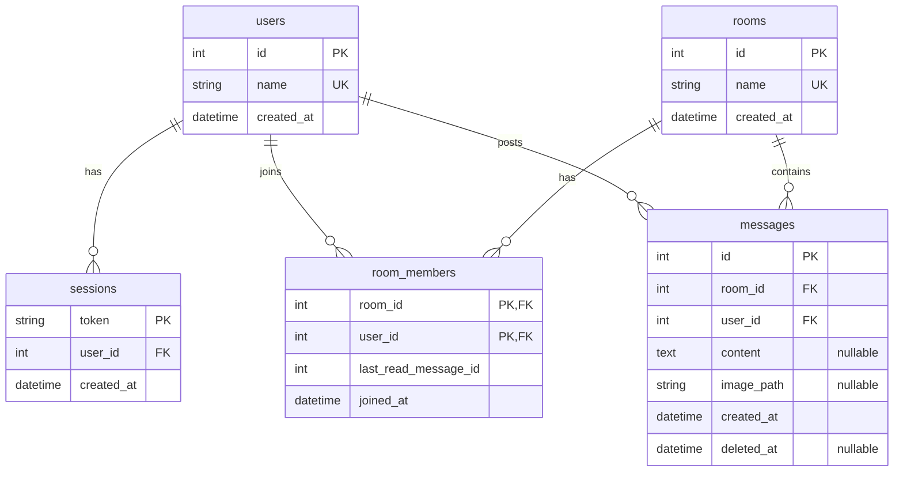

# Simple Chat

LINE 風の簡易チャットアプリです。ユーザー名だけで入室し、グループ（ルーム）に参加してリアルタイムでメッセージや画像をやり取りできます。

<!-- スクリーンショット / 動作動画へのリンクをここに追加 -->

## 機能

| 画面 | 機能 |
|---|---|
| ログイン (`/`) | ユーザー名で入室（未登録の名前は自動登録）。ログイン状態はブラウザに保持 |
| トーク一覧 (`/rooms`) | 参加中のトーク（**最新メッセージ・未読数**付き、新しい順）、参加できるルーム（参加ボタン）、ルーム作成、**ルーム名検索** |
| チャットルーム (`/rooms/:id`) | メッセージ送信フォーム（テキスト・**画像**）、メッセージ一覧、**送信取り消し**、**退会** |

- **グループチャット**：誰でもルームを作成でき、作成者は自動で参加。他のユーザーは一覧から自由に参加・退会できる（公開グループ）
- **未読数**：トーク一覧に未読件数をバッジ表示。ルームを開いている間は自動で既読になる（自分の投稿・取り消し済みは数えない）
- **最新メッセージ**：トーク一覧に「送信者: 本文」「〇〇が画像を送信しました」のプレビューと時刻を表示
- **送信取り消し**：自分のメッセージのみ。LINE と同様に「メッセージの送信を取り消しました」と表示され、相手の画面からも即座に消える
- **ルーム名検索**：部分一致・大文字小文字を区別しない。入力が止まってから 0.3 秒後にサーバーへ問い合わせ、参加中／参加できるルームの両方を絞り込む
- **画像送信**：JPEG / PNG / GIF / WebP、5MB まで。クリックで原寸表示
- 自分のメッセージは右側に緑、他人は左側に白＋名前・アイコン（LINE 風）、時刻と日付区切りを表示
- Enter で送信 / Shift+Enter で改行。**日本語入力の変換確定 Enter では送信しない**
- WebSocket によるリアルタイム配信（新着・取り消し・未読数）。切断時は自動再接続し、切断中のメッセージも補完
- 過去メッセージはカーソル型ページングで「過去のメッセージを読み込む」から取得

## 技術スタック

| 領域 | 技術 |
|---|---|
| フロントエンド | Next.js 16 (App Router) / React 19 / TypeScript / Tailwind CSS 4 |
| バックエンド | FastAPI / SQLAlchemy 2 / Pydantic 2 / Uvicorn |
| データベース | SQLite |
| ツール | uv（Python パッケージ管理）、pytest、Ruff、ESLint |

## セットアップ

### 必要なもの
- Python 3.13+ と [uv](https://docs.astral.sh/uv/)（`pip install uv` でも可）
- Node.js 20+

### 1. バックエンド

```bash
cd backend
uv sync
uv run uvicorn app.main:app --reload --port 8000
```

- 初回起動時に `backend/chat.db` が作成されます（ルームは空の状態から始まるので、画面から作成してください）
- アップロード画像は `backend/uploads/` に保存されます
- API ドキュメント（Swagger UI）: http://localhost:8000/docs （http://localhost:8000/ からも転送されます）
- 古いバージョンで作成した `chat.db` が残っている場合、起動時にスキーマ不一致のエラーで停止します。`chat.db` を削除して再起動してください

### 2. フロントエンド（別ターミナル）

```bash
cd frontend
npm install
npm run dev
```

http://localhost:3000 を開きます。動作確認は、別ブラウザ（またはシークレットウィンドウ）で別のユーザー名でログインし、同じルームに入るとリアルタイムで反映される様子が確認できます。

### 環境変数（任意）

| 変数 | 既定値 | 説明 |
|---|---|---|
| `DATABASE_URL` (backend) | `sqlite:///./chat.db` | DB の接続先 |
| `CORS_ORIGINS` (backend) | `http://localhost:3000,http://127.0.0.1:3000` | 許可するオリジン（カンマ区切り） |
| `UPLOAD_DIR` (backend) | `./uploads` | 画像の保存先 |
| `MAX_IMAGE_BYTES` (backend) | `5242880` | 画像の最大サイズ（バイト） |
| `NEXT_PUBLIC_API_BASE_URL` (frontend) | `http://localhost:8000` | バックエンドの URL |

それぞれ `backend/.env.example`、`frontend/.env.example` をコピーして `.env` / `.env.local` を作成すると上書きできます。

### テスト・Lint

```bash
cd backend && uv run pytest && uv run ruff check .
cd frontend && npm run lint && npm run format:check && npm run build
```

## ディレクトリ構成

```
.
├── backend/
│   ├── app/
│   │   ├── main.py        # アプリ生成、CORS、例外ハンドラ、起動時の DB 初期化
│   │   ├── config.py      # 環境変数による設定
│   │   ├── db.py          # エンジン・セッション
│   │   ├── models.py      # テーブル定義
│   │   ├── schemas.py     # API の入出力スキーマ（バリデーション）
│   │   ├── errors.py      # ドメイン例外（→ HTTP ステータスへ変換）
│   │   ├── deps.py        # 認証などの依存関数
│   │   ├── realtime.py    # WebSocket 接続管理・ユーザー単位の配信
│   │   ├── storage.py     # 画像の検証・保存・削除
│   │   ├── services/      # ビジネスロジック（auth / rooms / memberships / messages）
│   │   └── routers/       # エンドポイント定義
│   └── tests/             # API・WebSocket・権限・未読数・画像のテスト
└── frontend/src/
    ├── app/               # ページ（ログイン / ルーム一覧 / チャットルーム）
    ├── components/        # UI コンポーネント（RealtimeProvider: WebSocket 接続の共有）
    ├── hooks/             # useSession（ログイン状態）, useRoomMessages（取得・購読・送信・既読）
    └── lib/               # API クライアント、型、設定、整形ユーティリティ
```

バックエンドは **router（HTTP の入出力）→ service（ロジック）→ model（DB）** の 3 層に分けています。service は HTTP を知らずドメイン例外を投げ、`main.py` で一括して HTTP ステータスに変換します。

## API

| Method | Path | 説明 |
|---|---|---|
| POST | `/api/auth/login` | `{name}` で入室。ユーザーを取得または作成し `{token, user}` を返す |
| GET | `/api/auth/me` | 現在のユーザー |
| POST | `/api/auth/logout` | トークンを無効化 |
| GET | `/api/rooms?q=` | ルーム一覧（参加状態・人数・未読数・最新メッセージ付き、新しい順）。`q` でルーム名を部分一致検索 |
| POST | `/api/rooms` | ルーム作成 `{name}`。作成者は自動参加（同名は 409） |
| GET | `/api/rooms/{room_id}` | ルーム取得（同上の付加情報付き） |
| PUT | `/api/rooms/{room_id}/members/me` | 参加（冪等） |
| DELETE | `/api/rooms/{room_id}/members/me` | 退会（冪等） |
| PUT | `/api/rooms/{room_id}/read` | `{message_id}` まで既読にする（後退はしない） |
| GET | `/api/rooms/{room_id}/messages?before_id=&limit=50` | メッセージ一覧（古い順）と `has_more` ※ |
| POST | `/api/rooms/{room_id}/messages` | テキスト投稿 `{content}` ※ |
| POST | `/api/rooms/{room_id}/messages/images` | 画像投稿（multipart `file`） ※ |
| DELETE | `/api/rooms/{room_id}/messages/{message_id}` | 送信取り消し（自分のメッセージのみ） ※ |
| WS | `/ws?token=...` | 参加中ルームのイベントを配信 |

※ ルーム参加者のみ（未参加は 403）

- 認証は `Authorization: Bearer <token>`（WebSocket はクエリパラメータ）
- WebSocket イベント: `{"type": "message.created" | "message.deleted", "message": {...}}`。クローズコード `4401` は認証エラー
- メッセージは `content`（テキスト）か `image_url`（画像）のどちらかを持ち、取り消し済みは `is_deleted: true` で本文・画像とも `null`
- バリデーション: ユーザー名 1–20 文字、ルーム名 1–30 文字、本文 1–1000 文字（前後の空白は除去）、画像 5MB まで

## DB 設計



- `messages` には `(room_id, id)` の複合インデックスを張り、ルーム内のページングを効率化しています。
- **未読数は「既読位置」方式**：メッセージごとに既読レコードを持つのではなく、`room_members.last_read_message_id` だけを持ち、それより新しい他人のメッセージ数を未読とします。書き込みが 1 行の更新で済み、未読数は 1 クエリで集計できます。
- トーク一覧の集計（人数・未読数・最新メッセージ）はルーム横断の `GROUP BY` でまとめて取得し、N+1 クエリを避けています。

## 設計上の判断

要件があえて曖昧なため、以下のように解釈・判断しました。

- **「簡易的な認証」**：パスワードなしでユーザー名のみで入室し、同じ名前なら同じユーザーとして扱います。ただしユーザー名をそのまま識別子に使うのではなく **セッショントークンを発行**する形にしました。API は「トークンからユーザーを特定する」だけなので、将来パスワードや OAuth を導入してもログイン処理の差し替えだけで済みます。
- **グループチャット（公開グループ）**：「チャットルーム画面」という名称と LINE のグループトークから、複数人が参加するルームを単位にしました。招待・承認の仕組みは持たず、誰でも参加・退会できる公開グループとしています。参加者だけが閲覧・投稿・受信できるよう、API と WebSocket の両方で参加状態を確認します。
- **送信は REST、配信は WebSocket**：送信・取り消しを REST に一本化することで、バリデーション・権限・エラーレスポンスを通常の API と同じ仕組みで扱え、テストもしやすくなります。WebSocket はサーバー→クライアントの配信専用でシンプルに保っています。
- **WebSocket はユーザー単位で 1 本**：ルームごとに接続すると、トーク一覧の未読数や最新メッセージをリアルタイムに更新できません。ユーザーごとに 1 本だけ接続し、サーバーが「そのルームの参加者全員」に配信することで、一覧とチャット画面が同じ接続を共有します。退会すれば自然に届かなくなります。
- **取りこぼし対策**：WebSocket の（再）接続のたびに REST で最新ページを取得し、メッセージ ID で重複排除してマージしています。送信者は REST のレスポンスで即座に自分のメッセージを表示します。
- **送信取り消しは論理削除**：レコードは残して `deleted_at` を記録し、本文と画像ファイルは消去します。履歴上の位置が保たれ、LINE と同じく「取り消しました」と表示できます。取り消しは本人のみ可能です。
- **画像は中身で検証**：拡張子や Content-Type はクライアントの申告なので信用せず、先頭バイト列（マジックナンバー）で形式を判定し、推測不能な UUID のファイル名で保存します。保存処理は `storage.py` に閉じているので、S3 などへの差し替えも容易です。
- **検索はサーバー側で実行**：全件を取得してクライアントで絞り込むのではなく `?q=` で問い合わせます。ルーム数が増えても転送量が増えず、一覧 API の 1 つのパラメータとして自然に拡張できます。`%` と `_` はエスケープして通常の文字として扱います。
- **カーソル型ページング**：`OFFSET` ではなく `before_id` を使うことで、新着メッセージが増えても取得範囲がずれません。
- **日時は UTC で保存**し、ISO 8601（タイムゾーン付き）で返却、表示時にブラウザのローカル時刻へ変換します。

## 制約と今後の拡張案

- 接続管理はプロセス内メモリのため、単一プロセス前提です。複数プロセス／サーバーで動かす場合は `realtime.py` の配信を Redis Pub/Sub 等に置き換えます。
- テーブルは起動時に `create_all` で作成しています。スキーマ変更が発生する運用では Alembic によるマイグレーションを導入します（現状はスキーマ不一致を検出して停止するのみ）。
- 画像の URL は推測不能ですが認証はかけていません。非公開にする場合は認証付きの配信エンドポイント（または署名付き URL）に置き換えます。
- トークンに有効期限がありません（`sessions.created_at` を使って期限切れを判定する拡張が可能）。
- **個人チャット（1 対 1）**：`rooms` に種別（group / direct）を追加し、2 人のメンバーで作成すれば現在の仕組み（メンバー・未読・配信）をそのまま使えます。
- **招待制のグループ**：`room_invitations`（招待者・被招待者・状態）を追加し、承認時に `room_members` へ追加する形で拡張できます。
- 既読表示（「既読 3」）、入力中表示、メッセージ編集などは未実装です。既読表示は各メンバーの `last_read_message_id` から計算できます。
