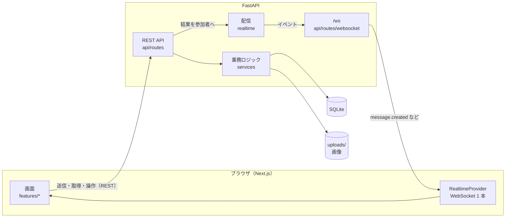
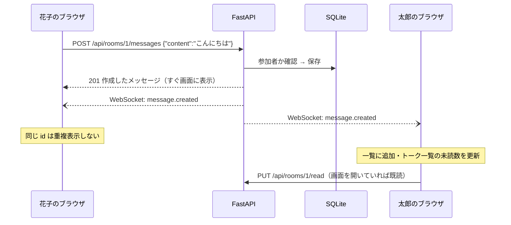
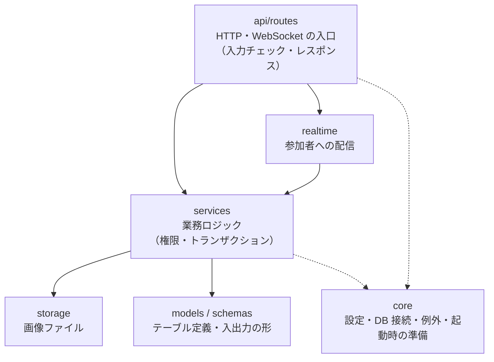
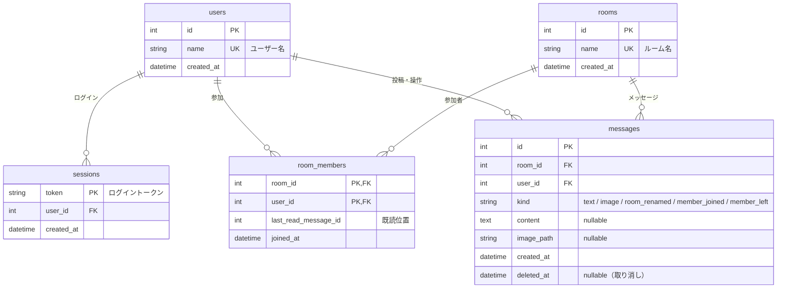

# Simple Chat

LINE 風のグループチャットアプリです。ユーザー名だけで入室し、ルームに参加して、テキストや画像をリアルタイムにやり取りできます。

- フロントエンド：Next.js（App Router）／ バックエンド：FastAPI ／ DB：SQLite
- 送信は REST API、新着の配信は WebSocket

<!-- スクリーンショット・動作動画をここに -->

---

## 目次

1. [機能](#機能)
2. [クイックスタート](#クイックスタート)
3. [アーキテクチャ](#アーキテクチャ)
4. [ディレクトリ構成](#ディレクトリ構成)
5. [API](#api)
6. [DB 設計](#db-設計)
7. [設計上の判断](#設計上の判断)
8. [開発](#開発)
9. [制約と今後の拡張](#制約と今後の拡張)

---

## 機能

| 画面 | できること |
|---|---|
| **ログイン**（`/`） | ユーザー名で入室。初めての名前なら自動で登録される |
| **トーク一覧**（`/rooms`） | 参加中のトーク（最新メッセージ・時刻・**未読数**、新しい順）／ 参加できるルーム（参加ボタン）／ ルーム作成 ／ **ルーム名検索** |
| **チャット**（`/rooms/:id`） | テキスト・**画像**の送信 ／ メッセージ一覧 ／ **送信取り消し** ／ **トーク名の変更** ／ **退会** |

**チャットの振る舞い**
- 自分の発言は右に緑、他人の発言は左に白で名前とアイコン付き。時刻と日付の区切りも表示
- Enter で送信、Shift+Enter で改行。**日本語入力の変換確定の Enter では送信しない**
- 参加・退会・トーク名変更は、トーク内に「〇〇が参加しました」などのお知らせとして表示
- 取り消したメッセージは「〇〇がメッセージの送信を取り消しました」と表示（本人のみ取り消せる）
- 画面を開いている間は自動で既読。未読数は自分の投稿・お知らせ・取り消し済みを数えない
- 上にスクロールして「過去のメッセージを読み込む」で過去ログを表示
- 接続が切れても自動で再接続し、切れている間のメッセージも補完

**ルームの仕様**：誰でも作成でき、作成者は自動で参加。他の人は一覧から自由に参加・退会できる（公開グループ）。参加者だけがメッセージを読み書き・受信できる。

---

## クイックスタート

必要なもの：Python 3.13 以上と [uv](https://docs.astral.sh/uv/)（`pip install uv` でも可）、Node.js 20 以上

```bash
# 1. バックエンド（http://localhost:8000）
cd backend
uv sync
uv run uvicorn app.main:app --reload

# 2. フロントエンド（http://localhost:3000）※別のターミナルで
cd frontend
npm install
npm run dev
```

> Windows で `uv` コマンドが見つからない場合は、`python -m uv sync` のように `python -m uv` で実行できます。

http://localhost:3000 を開いてユーザー名を入力します。
**2 人でのやり取りを試すには**、通常のウィンドウとシークレットウィンドウで別の名前でログインし、片方がルームを作成、もう片方が「参加」すると、送信・未読数・お知らせがリアルタイムに反映される様子を確認できます。

- API の一覧と試し打ち：http://localhost:8000/docs
- 初回起動時に `backend/chat.db`（DB）と `backend/uploads/`（画像）が作られます

---

## アーキテクチャ

### 全体像



- **送信や操作はすべて REST**、**サーバーからの通知は WebSocket** と役割を分けています。
- WebSocket は **ユーザーごとに 1 本** だけ張り、サーバーは「そのルームの参加者全員」にイベントを送ります。トーク一覧（未読数）とチャット画面が同じ接続を共有します。

### メッセージ送信の流れ



### バックエンドの層と依存の向き



- 依存は **上から下への一方向** です。`services` は HTTP も WebSocket も知らず、失敗は `core/errors.py` の例外（`NotFoundError` など）を投げるだけです。HTTP ステータスへの変換は `main.py` で一括して行います。
- 権限チェック（ルームの存在確認・参加者か）は `services/room_access.py` の 1 か所に集めています。

### フロントエンドの構成

- `app/` はルーティングだけを持ち、各ページは `features/` の画面コンポーネントを置くだけです。
- `features/` は機能ごとのフォルダです：`auth`（ログイン・ログイン必須の制御）、`realtime`（WebSocket）、`rooms`（トーク一覧）、`chat`（チャット画面）。
- 画面をまたいで使うものは `components/`（ボタン・ヘッダーなど）、`hooks/`、`lib/`（API クライアント・型・表示用の関数）に置いています。

---

## ディレクトリ構成

```
.
├── backend/
│   ├── app/
│   │   ├── main.py              アプリの組み立て（ルーター登録・CORS・例外→HTTP 変換・起動時の DB 準備）
│   │   ├── core/                設定（config）・DB 接続（database）・ドメイン例外（errors）・起動時のスキーマ準備（migrations）
│   │   ├── models/              テーブル定義（user / room / message）
│   │   ├── schemas/             API の入出力と WebSocket イベントの形（auth / room / message / event）
│   │   ├── services/            業務ロジック
│   │   │   ├── room_access.py       ルームの存在確認と参加者チェック（権限の判定はここだけ）
│   │   │   ├── system_messages.py   「参加しました」などのお知らせの作成
│   │   │   ├── auth.py              ログイン・トークン検証・ログアウト
│   │   │   ├── rooms.py             ルームの作成・名前変更
│   │   │   ├── members.py           参加・退会・既読
│   │   │   ├── messages.py          メッセージの一覧・投稿・取り消し
│   │   │   └── room_summaries.py    一覧用の集計（人数・未読数・最新メッセージ）と検索
│   │   ├── storage/images.py    画像の検証・保存・削除
│   │   ├── realtime/            WebSocket の接続管理（connections）と参加者への配信（publisher）
│   │   └── api/
│   │       ├── deps.py              DB セッション・ログイン中ユーザーの取得
│   │       └── routes/              auth / rooms / members / messages / websocket
│   └── tests/                   API 単位のテスト（共通の準備は conftest.py）
│
└── frontend/src/
    ├── app/                     ルーティング（/、/rooms、/rooms/[roomId]）
    ├── features/
    │   ├── auth/                ログインフォーム・ログイン必須の制御（SessionGuard）
    │   ├── realtime/            WebSocket 接続の共有（RealtimeProvider）
    │   ├── rooms/               トーク一覧画面（一覧・検索・作成・参加）
    │   └── chat/                チャット画面（メッセージ一覧・吹き出し・入力欄・トーク名編集）
    ├── components/              共通の UI（AppHeader / Button / ErrorMessage / Avatar / CenteredScreen）
    ├── hooks/                   useAsyncAction（実行中・エラー表示）/ useDebouncedValue
    └── lib/
        ├── api/                 API クライアント（client）と呼び出し一覧（endpoints）
        ├── messages.ts          表示文（「〇〇が参加しました」など）・重複除去
        ├── datetime.ts          日時の表示
        ├── session.ts           ログイン情報の保存（localStorage）
        └── types.ts / config.ts / keyboard.ts
```

---

## API

認証：`Authorization: Bearer <token>`（ログインで発行）。WebSocket はクエリパラメータ `?token=`。

### REST

| Method | Path | 説明 |
|---|---|---|
| POST | `/api/auth/login` | `{name}` で入室。ユーザーを取得または作成し `{token, user}` を返す |
| GET | `/api/auth/me` | ログイン中のユーザー |
| POST | `/api/auth/logout` | トークンを無効にする |
| GET | `/api/rooms?q=` | ルーム一覧（参加状態・人数・未読数・最新メッセージ付き、新しい順）。`q` でルーム名を部分一致検索 |
| POST | `/api/rooms` | ルーム作成 `{name}`。作成者は自動で参加 |
| GET | `/api/rooms/{id}` | ルームの取得 |
| PATCH | `/api/rooms/{id}` | トーク名の変更 `{name}` ※ |
| PUT | `/api/rooms/{id}/members/me` | 参加（何度呼んでも同じ結果） |
| DELETE | `/api/rooms/{id}/members/me` | 退会（何度呼んでも同じ結果） |
| PUT | `/api/rooms/{id}/read` | `{message_id}` まで既読にする（後退はしない）※ |
| GET | `/api/rooms/{id}/messages?before_id=&limit=50` | メッセージ一覧（古い順）と `has_more` ※ |
| POST | `/api/rooms/{id}/messages` | テキスト投稿 `{content}` ※ |
| POST | `/api/rooms/{id}/messages/images` | 画像投稿（multipart の `file`）※ |
| DELETE | `/api/rooms/{id}/messages/{message_id}` | 送信取り消し（自分の投稿のみ）※ |

※ ルームの参加者のみ。主なエラー：401 未ログイン ／ 403 権限なし（未参加・他人の投稿）／ 404 存在しない ／ 409 同名のルーム ／ 413 画像が大きすぎる ／ 415 画像以外 ／ 422 入力不正

入力の制限：ユーザー名 1〜20 文字、ルーム名 1〜30 文字、本文 1〜1000 文字（前後の空白は除去）、画像は JPEG / PNG / GIF / WebP で 5MB まで。

### WebSocket（`/ws?token=...`）

サーバーからクライアントへの通知専用です。参加中のルームのイベントだけが届きます。

| type | 内容 | いつ |
|---|---|---|
| `message.created` | `{message}` | 投稿、またはお知らせ（参加・退会・名前変更）の作成 |
| `message.deleted` | `{message}`（`is_deleted: true`） | 送信取り消し |
| `room.updated` | `{room: {id, name, member_count}}` | 名前変更・参加・退会 |

認証に失敗するとクローズコード `4401` で切断します。

### メッセージの種類（`kind`）

| kind | 意味 | content |
|---|---|---|
| `text` | テキストの投稿 | 本文 |
| `image` | 画像の投稿（`image_url` に URL） | null |
| `room_renamed` | お知らせ：トーク名の変更 | 変更後の名前 |
| `member_joined` | お知らせ：参加 | null |
| `member_left` | お知らせ：退会 | null |

お知らせの `user` は操作した人です。取り消し済みは `is_deleted: true` で、`content` と `image_url` は null になります。

---

## DB 設計



- **未読数は「既読位置」方式**：メッセージごとに既読の記録を持つのではなく、`room_members.last_read_message_id` だけを持ちます。未読数は「既読位置より新しい、他人の投稿の数」として 1 回の集計で求まり、既読にする処理も 1 行の更新で済みます。
- `messages` には `(room_id, id)` の複合インデックスを張り、ルーム内のページングを速くしています。
- トーク一覧の集計（人数・未読数・最新メッセージ）は、ルームごとにクエリを投げず `GROUP BY` でまとめて取得しています（N+1 を避ける）。
- 日時は UTC で保存し、API ではタイムゾーン付きの ISO 8601 で返します。表示はブラウザのローカル時刻です。

---

## 設計上の判断

課題の要件はあえて曖昧にされているため、次のように解釈・判断しました。

| テーマ | 判断 | 理由 |
|---|---|---|
| 簡易的な認証 | パスワードなし・ユーザー名だけで入室。ただし **トークンを発行** する | API は「トークンから本人を特定する」だけにしておけば、将来パスワードや OAuth を入れてもログイン処理の差し替えで済む |
| 個人かグループか | **グループ（公開ルーム）**。誰でも参加・退会できる | 「チャットルーム」という言葉と LINE のグループトークから。参加者だけが読み書きできるよう、API と WebSocket の両方で確認する |
| 送信と配信 | **送信は REST、配信は WebSocket** | 入力チェック・権限・エラー応答を通常の API と同じ仕組みで扱え、テストもしやすい。WebSocket は通知専用で単純に保てる |
| WebSocket の単位 | **ユーザーごとに 1 本** | ルームごとに繋ぐとトーク一覧の未読数を更新できない。サーバーが参加者に配る形なら、退会すれば自然に届かなくなる |
| 取りこぼし対策 | 接続・再接続のたびに REST で最新を取り直し、**id で重複を除く** | WebSocket が切れていた間のメッセージも失わない。送信者は API のレスポンスで即座に表示できる |
| お知らせ | **messages に種類（kind）を付けて同じ表に保存** | 並び順・ページング・配信・既読の仕組みをそのまま使える。文言は保存せず画面側で組み立てる |
| 送信取り消し | **論理削除**（本文と画像は消す） | 履歴上の位置が残り、LINE と同じく「取り消しました」と表示できる |
| 画像 | **中身（先頭バイト）で形式を判定**、推測できない UUID のファイル名で保存 | 拡張子や Content-Type はクライアントの自己申告なので信用しない。保存処理は `storage/` に閉じており S3 などへの差し替えも容易 |
| 過去ログ | **カーソル方式**（`before_id`） | OFFSET 方式と違い、新着が増えても取得範囲がずれない |
| 検索 | **サーバー側で検索**（`?q=`、`%` `_` はエスケープ） | ルームが増えても通信量が増えない |
| トーク名の変更 | **参加者なら誰でも** | LINE のグループと同じ。権限を絞るなら `room_members` に役割を追加して `room_access` で判定する |

---

## 開発

### テスト・静的チェック

```bash
cd backend
uv run pytest            # API・WebSocket・権限・未読数・画像・お知らせ・移行のテスト
uv run ruff check .      # Lint
uv run ruff format .     # 整形

cd frontend
npm run lint             # ESLint
npm run format           # Prettier で整形（確認だけなら npm run format:check）
npm run build            # 型チェックを含む本番ビルド
```

### 環境変数（すべて任意）

| 変数 | 既定値 | 説明 |
|---|---|---|
| `DATABASE_URL`（backend） | `sqlite:///./chat.db` | DB の接続先 |
| `CORS_ORIGINS`（backend） | `http://localhost:3000,http://127.0.0.1:3000` | 許可するオリジン（カンマ区切り） |
| `UPLOAD_DIR`（backend） | `./uploads` | 画像の保存先 |
| `MAX_IMAGE_BYTES`（backend） | `5242880` | 画像の最大サイズ（バイト） |
| `NEXT_PUBLIC_API_BASE_URL`（frontend） | `http://localhost:8000` | バックエンドの URL |

`backend/.env.example`、`frontend/.env.example` をコピーして `.env` / `.env.local` を作ると上書きできます。

### DB のスキーマ変更について

起動時に `core/migrations.py` が、足りないテーブルを作り、既存データを保ったまま追加できる列（`messages.kind`）を自動で追加します。それ以外の違いがある古い DB の場合は、分かりやすいエラーで停止するので `backend/chat.db` を削除して再起動してください。

---

## 制約と今後の拡張

- **単一プロセス前提**：WebSocket の接続はメモリ上で管理しています。複数プロセス・複数サーバーで動かす場合は `realtime/connections.py` の送信を Redis Pub/Sub などに置き換えます。
- **マイグレーション**：本格的に運用する場合は Alembic を導入します。
- **画像の公開範囲**：URL は推測できませんが認証はかけていません。非公開にするなら認証付きの配信や署名付き URL にします。
- **トークンの有効期限**：未実装です（`sessions.created_at` を使って判定できます）。
- **個人チャット（1 対 1）**：`rooms` に種類（group / direct）を追加し、2 人で作れば、参加者・未読・配信の仕組みをそのまま使えます。
- **招待制のグループ**：招待の表（招待した人・された人・状態）を追加し、承認したら `room_members` に追加します。
- **既読表示（「既読 3」）**：各参加者の `last_read_message_id` から計算できます。入力中の表示やメッセージの編集は未実装です。
