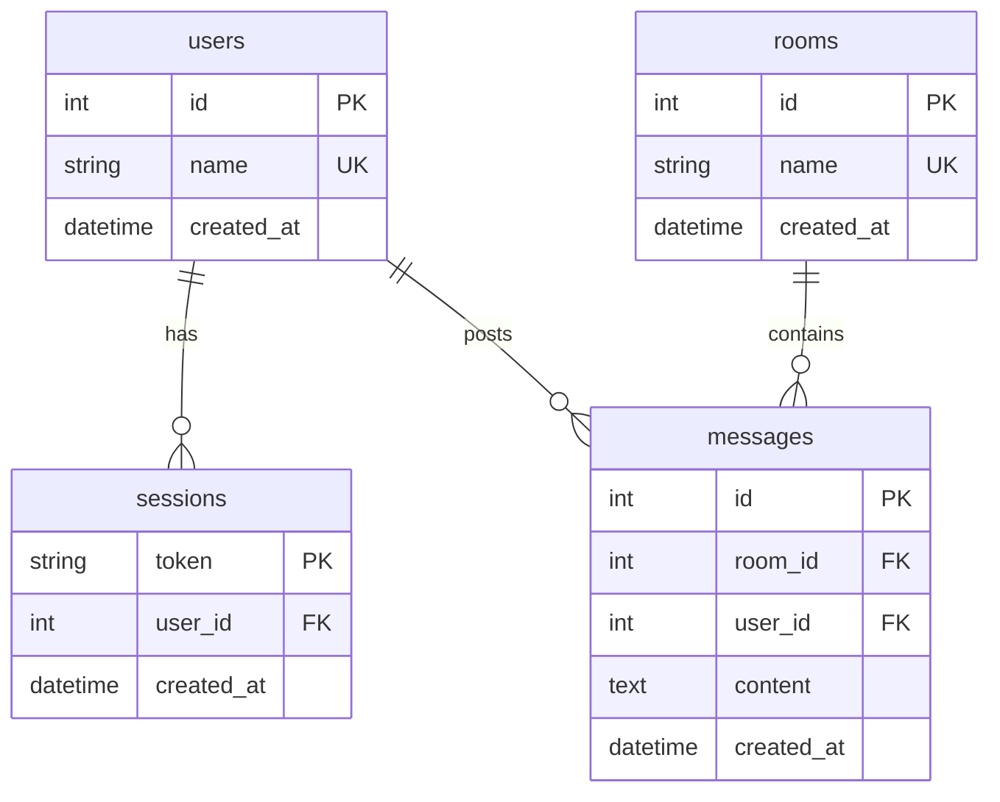

# Simple Chat

LINE 風の簡易チャットアプリです。ユーザー名だけで入室し、ルームごとにリアルタイムでメッセージをやり取りできます。

<!-- スクリーンショット / 動作動画へのリンクをここに追加 -->

## 機能

| 画面 | 機能 |
|---|---|
| ログイン (`/`) | ユーザー名で入室（未登録の名前は自動登録）。ログイン状態はブラウザに保持 |
| ルーム一覧 (`/rooms`) | ルームの一覧表示・新規作成・入室 |
| チャットルーム (`/rooms/:id`) | メッセージ送信フォーム、メッセージ一覧（リアルタイム更新・過去ログ読み込み） |

- 自分のメッセージは右側に緑、他人は左側に白＋名前・アイコン（LINE 風）、時刻と日付区切りを表示
- Enter で送信 / Shift+Enter で改行。**日本語入力の変換確定 Enter では送信しない**
- WebSocket によるリアルタイム配信。切断時は自動再接続し、切断中のメッセージも補完
- 過去メッセージはカーソル型ページングで「過去のメッセージを読み込む」から取得

## 技術スタック

| 領域 | 技術 |
|---|---|
| フロントエンド | Next.js 16 (App Router) / React 19 / TypeScript / Tailwind CSS 4 |
| バックエンド | FastAPI / SQLAlchemy 2 / Pydantic 2 / Uvicorn |
| データベース | SQLite |
| ツール | uv（Python パッケージ管理）、pytest、Ruff、ESLint |

## セットアップ

### 必要なもの
- Python 3.13+ と [uv](https://docs.astral.sh/uv/)（`pip install uv` でも可）
- Node.js 20+

### 1. バックエンド

```bash
cd backend
uv sync
uv run uvicorn app.main:app --reload --port 8000
```

- 初回起動時に `backend/chat.db` が作成され、ルーム「General」が自動で作られます
- API ドキュメント（Swagger UI）: http://localhost:8000/docs

### 2. フロントエンド（別ターミナル）

```bash
cd frontend
npm install
npm run dev
```

http://localhost:3000 を開きます。動作確認は、別ブラウザ（またはシークレットウィンドウ）で別のユーザー名でログインし、同じルームに入るとリアルタイムで反映される様子が確認できます。

### 環境変数（任意）

| 変数 | 既定値 | 説明 |
|---|---|---|
| `DATABASE_URL` (backend) | `sqlite:///./chat.db` | DB の接続先 |
| `CORS_ORIGINS` (backend) | `http://localhost:3000,http://127.0.0.1:3000` | 許可するオリジン（カンマ区切り） |
| `NEXT_PUBLIC_API_BASE_URL` (frontend) | `http://localhost:8000` | バックエンドの URL |

それぞれ `backend/.env.example`、`frontend/.env.example` をコピーして `.env` / `.env.local` を作成すると上書きできます。

### テスト・Lint

```bash
cd backend && uv run pytest && uv run ruff check .
cd frontend && npm run lint && npm run build
```

## ディレクトリ構成

```
.
├── backend/
│   ├── app/
│   │   ├── main.py        # アプリ生成、CORS、例外ハンドラ、起動時の DB 初期化
│   │   ├── config.py      # 環境変数による設定
│   │   ├── db.py          # エンジン・セッション
│   │   ├── models.py      # テーブル定義
│   │   ├── schemas.py     # API の入出力スキーマ（バリデーション）
│   │   ├── errors.py      # ドメイン例外（→ HTTP ステータスへ変換）
│   │   ├── deps.py        # 認証などの依存関数
│   │   ├── realtime.py    # WebSocket 接続管理・ルーム単位のブロードキャスト
│   │   ├── services/      # ビジネスロジック（HTTP に依存しない）
│   │   └── routers/       # エンドポイント定義
│   └── tests/             # API・WebSocket のテスト
└── frontend/src/
    ├── app/               # ページ（ログイン / ルーム一覧 / チャットルーム）
    ├── components/        # UI コンポーネント
    ├── hooks/             # useSession（ログイン状態）, useRoomMessages（取得・購読・送信）
    └── lib/               # API クライアント、型、設定、整形ユーティリティ
```

バックエンドは **router（HTTP の入出力）→ service（ロジック）→ model（DB）** の 3 層に分けています。service は HTTP を知らずドメイン例外を投げ、`main.py` で一括して HTTP ステータスに変換します。

## API

| Method | Path | 説明 |
|---|---|---|
| POST | `/api/auth/login` | `{name}` で入室。ユーザーを取得または作成し `{token, user}` を返す |
| GET | `/api/auth/me` | 現在のユーザー |
| POST | `/api/auth/logout` | トークンを無効化 |
| GET | `/api/rooms` | ルーム一覧 |
| POST | `/api/rooms` | ルーム作成 `{name}`（同名は 409） |
| GET | `/api/rooms/{room_id}` | ルーム取得 |
| GET | `/api/rooms/{room_id}/messages?before_id=&limit=50` | メッセージ一覧（古い順）と `has_more` |
| POST | `/api/rooms/{room_id}/messages` | メッセージ投稿 `{content}` → 同ルームへ配信 |
| WS | `/ws/rooms/{room_id}?token=...` | 新着配信 `{"type": "message.created", "message": {...}}` |

- 認証は `Authorization: Bearer <token>`（WebSocket はクエリパラメータ）
- WebSocket のクローズコード: `4401` 認証エラー / `4404` ルームなし
- バリデーション: ユーザー名 1–20 文字、ルーム名 1–30 文字、本文 1–1000 文字（前後の空白は除去）

## DB 設計



`messages` には `(room_id, id)` の複合インデックスを張り、ルーム内のページングを効率化しています。

## 設計上の判断

要件があえて曖昧なため、以下のように解釈・判断しました。

- **「簡易的な認証」**：パスワードなしでユーザー名のみで入室し、同じ名前なら同じユーザーとして扱います。ただしユーザー名をそのまま識別子に使うのではなく **セッショントークンを発行**する形にしました。API は「トークンからユーザーを特定する」だけなので、将来パスワードや OAuth を導入してもログイン処理の差し替えだけで済みます。
- **複数ルーム対応**：「チャットルーム画面」という名称から、ルームという単位を DB/API に持たせました。必須の 2 画面に加え、ルームを選ぶための一覧画面を用意しています。
- **リアルタイム更新は WebSocket、送信は REST**：送信を REST に一本化することで、バリデーション・認証・エラーレスポンスを通常の API と同じ仕組みで扱え、テストもしやすくなります。WebSocket はサーバー→クライアントの配信専用でシンプルに保っています。
- **取りこぼし対策**：WebSocket の接続（再接続）のたびに REST で最新ページを取得し、メッセージ ID で重複排除してマージしています。送信者は REST のレスポンスで即座に自分のメッセージを表示します。
- **カーソル型ページング**：`OFFSET` ではなく `before_id` を使うことで、新着メッセージが増えても取得範囲がずれません。
- **日時は UTC で保存**し、ISO 8601（タイムゾーン付き）で返却、表示時にブラウザのローカル時刻へ変換します。

## 制約と今後の拡張案

- 接続管理はプロセス内メモリのため、単一プロセス前提です。複数プロセス／サーバーで動かす場合は `realtime.py` の broadcast を Redis Pub/Sub 等に置き換えます。
- テーブルは起動時に `create_all` で作成しています。スキーマ変更が発生する運用では Alembic によるマイグレーションを導入します。
- トークンに有効期限がありません（`sessions.created_at` を使って期限切れを判定する拡張が可能）。
- 既読表示、入力中表示、メッセージの編集・削除、画像送信、ルームのメンバー管理などは未実装です。
